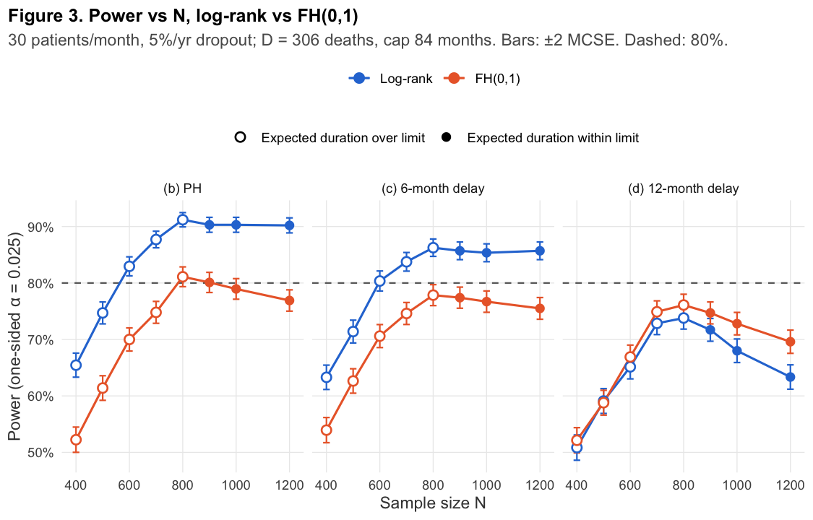

# How delayed treatment effects change oncology trial power

What happens to an oncology trial’s power if the treatment takes a year to start working? I ran **768,000 simulated trials across 192 scenarios** to see how the answer changes with enrollment, dropout, sample size, and the choice of statistical test. I compared the standard log-rank test with the Fleming–Harrington FH(0,1) weighted log-rank test, which gives more weight to later deaths.

[Try the live Shiny calculator](https://john-pendergrass-oncology-design-calculator.share.connect.posit.cloud/) · [Read the full report](report/report.md) · [See the pre-specified design](docs/design_spec.md)

## What the study found

**With a 12-month delay, none of the designs reached 80% power.** In the pre-specified base case (30 patients enrolled per month and 5% annual dropout), the closest design enrolled **900 patients** and used **FH(0,1)**. It achieved **74.7% power** with an expected analysis time of **62.7 months**, within the six-year target. The trial was analyzed at 306 deaths or 84 months after activation, whichever came first.

- **When the benefit started immediately, standard log-rank performed best.** At 900 patients under proportional hazards, it had 90.3% power, compared with 80.1% for FH(0,1). Log-rank still led with a six-month delay, reaching 85.7% power.
- **With a year-long delay, weighting later deaths helped.** At 900 patients, FH(0,1) gained 3.0 percentage points over log-rank. At 1,200 patients, the gain was 6.2 points.
- **A larger trial sometimes had less power.** In the base case, log-rank power fell from 73.8% at 800 patients to 63.3% at 1,200. With the death target fixed, enrolling more patients brought the analysis forward. More of the observed deaths then came from patients still within their first year of follow-up, before the modeled treatment benefit began.



## How the study worked

I fit a piecewise-exponential control survival model to the observation arm of the `survival::colon` dataset. I used that model to simulate two-arm, event-driven overall survival trials under four scenarios: no treatment benefit, immediate benefit, and benefits beginning after six or 12 months. The delayed effects were hypothetical. The historical trial informed the control hazard and the size of the treatment effect once it began (hazard ratio 0.69).

I ran both tests on the same simulated trials and validated the implementations against `survival`, `nphRCT`, and `simtrial`. Across 48 null scenarios, the estimated false-positive rates ranged from 2.21% to 2.86% for log-rank and from 2.02% to 2.77% for FH(0,1), around the nominal one-sided 2.5% level. The [pre-specified decision rule](docs/design_spec.md) required each sample size and test combination to stay at or below 2.81% across its null scenarios before being considered for recommendation. The [full report](report/report.md) covers the scenario grid and limitations.

## Try the calculator

In the [Shiny app](https://john-pendergrass-oncology-design-calculator.share.connect.posit.cloud/), set the sample size to 900 and compare a six-month delay with a 12-month delay. Keep enrollment at 30 per month, annual dropout at 5%, the hazard ratio at 0.69, and the analysis triggers at 306 deaths and 84 months. The app reports simulated power for both tests, Monte Carlo standard errors, expected analysis time, and how often the calendar limit triggers the analysis. It uses the same simulation functions as the study and lets you explore designs beyond the original grid.

## Reproduce the study

The project was developed with R 4.5.1. From the repository root:

```sh
Rscript -e 'renv::restore()'
Rscript run_all.R
```

`run_all.R` runs calibration, design calculations, a pilot, the full simulation grid, reporting, and tests. The simulation stage reuses cached replicates in `results/reps/` when available. To rerun every simulation from scratch, move that directory aside before running the pipeline.

The [core R functions](R/), [pipeline scripts](scripts/), [scenario results](results/scenario_summary.csv), and [tests](tests/testthat/) are included in the repository. To run the calculator locally, use `Rscript -e 'shiny::runApp("app")'`.
