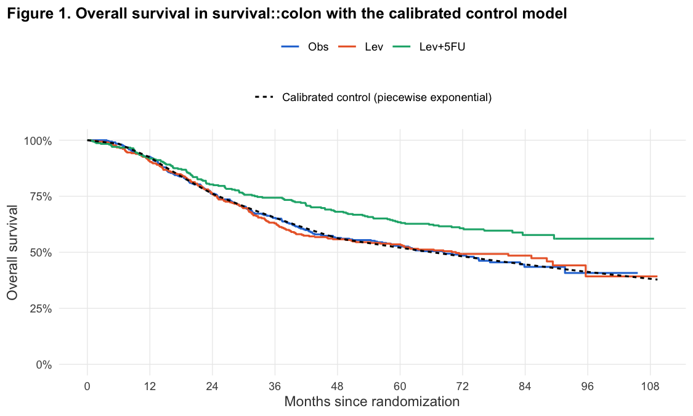
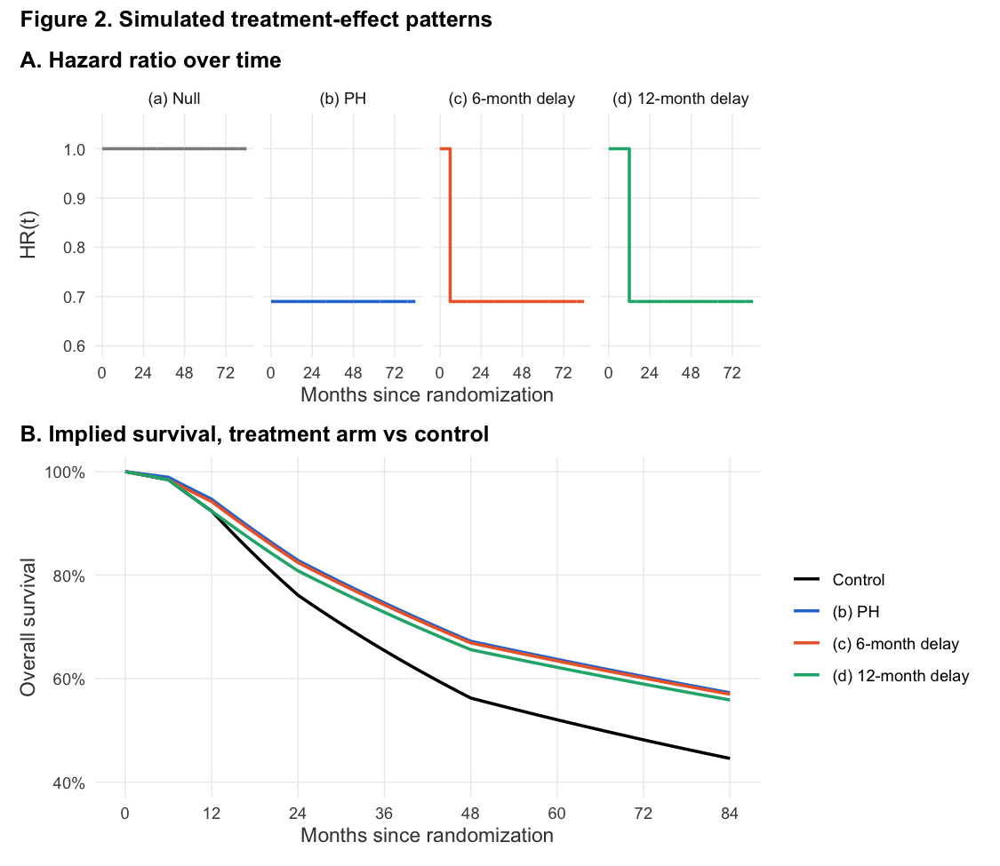
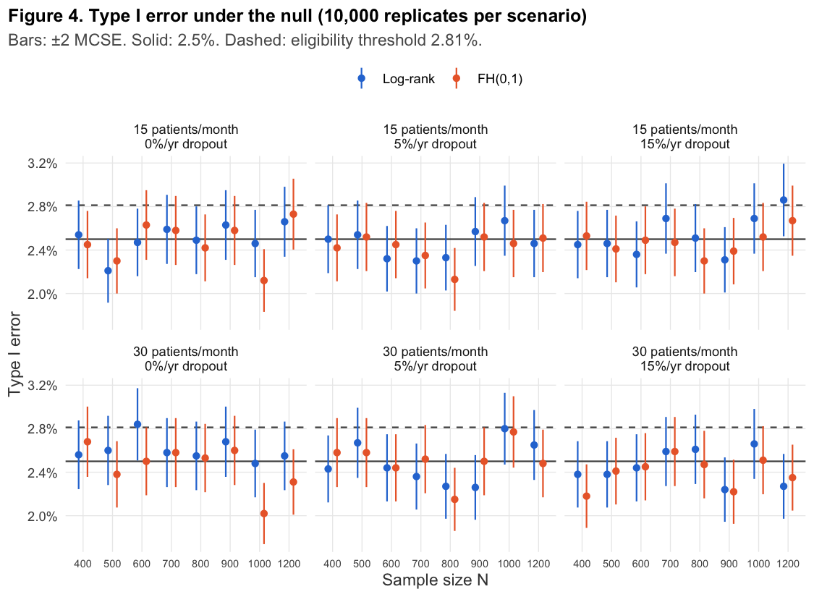
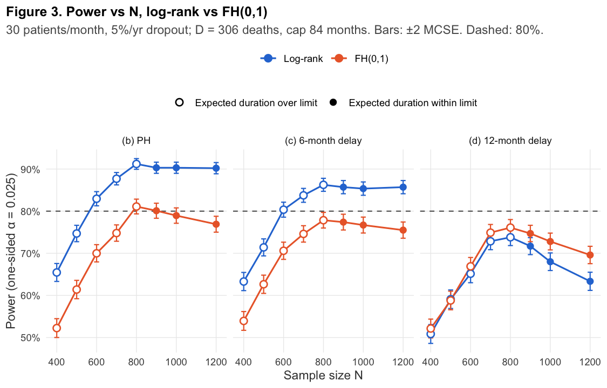
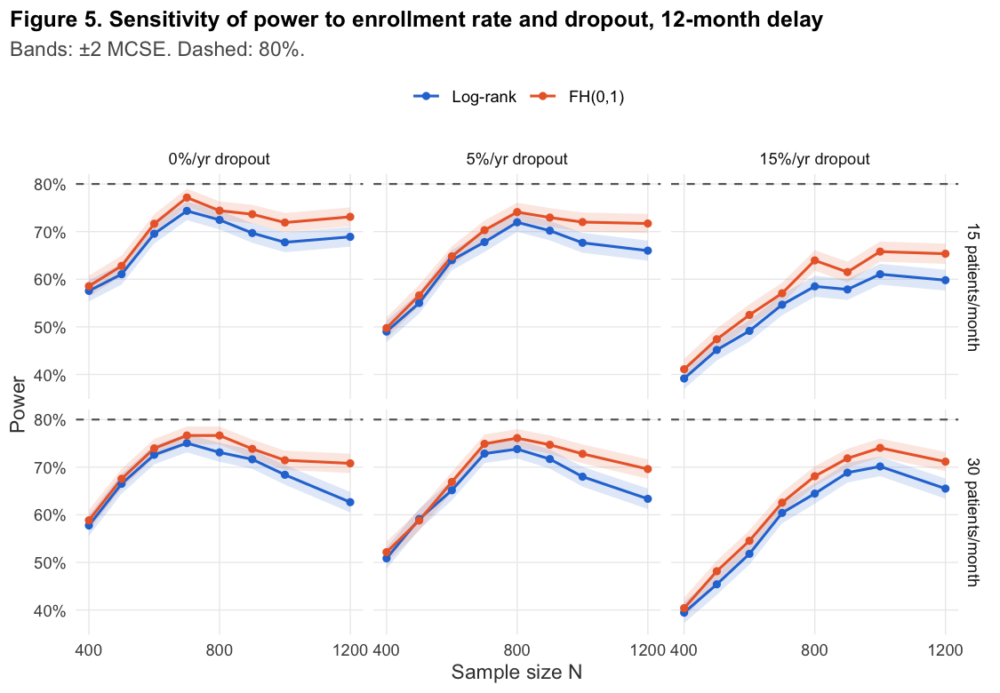
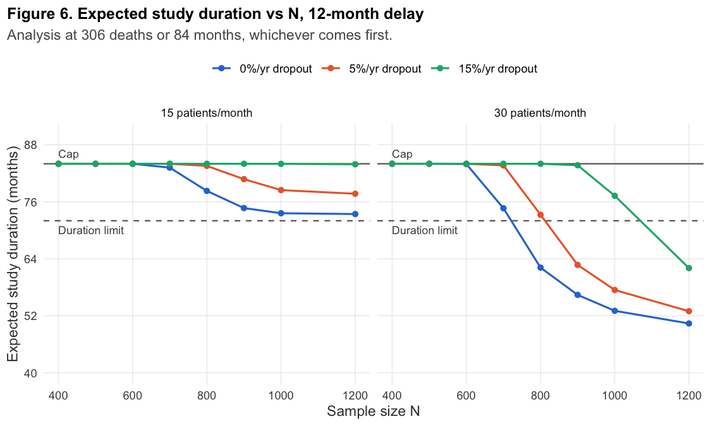

## 1. The question

A two-arm, 1:1 randomized trial with overall survival (OS) as the primary endpoint is analyzed when a
pre-specified number of deaths has accrued. How do the **enrollment rate**, **dropout** and a
**delayed treatment effect** change its power? And does analyzing with a test designed for delayed
effects, the Fleming–Harrington FH(0,1) weighted log-rank test, change which design we should
recommend, compared with the standard log-rank test?

We answer this with a pre-specified simulation study of 192 scenarios and
768,000 simulated trials. Both tests are applied to the same
simulated datasets, so the method comparison is paired. The full specification is in
[`docs/design_spec.md`](../docs/design_spec.md). It was written and approved before any scenario was run.

## 2. Data grounding

The control arm is calibrated to the observation-only (Obs) arm of `survival::colon`, a 1980s adjuvant
chemotherapy trial in resected colon cancer. Filtering to the death records (`etype == 2`) leaves one
row per patient: 929 patients and 452 deaths.
The median follow-up, by reverse Kaplan–Meier, is 77.3 months.

**Control hazard.** The Obs-arm hazard is not monotone:
- 0.032 deaths per person-year in months 0–6
- a peak of 0.194 in months 12–24
- a fall to 0.077 after month 48

A Weibull hazard can only increase or decrease, so it cannot follow this shape. We used a
five-interval piecewise-exponential (PWE) model instead (Figure 1). Its AIC is
1854.0, against 1881.1 for the Weibull. It stays within
0.020 of the Kaplan–Meier curve, against 0.082
for the Weibull. Fitting the early hazard closely matters here, because that is the period a delayed
effect acts on.

**Effect size.** The Cox HR for Lev+5FU vs Obs is 0.689
(95% CI 0.546–0.869). The `cox.zph` test shows
no evidence against proportional hazards (p = 0.28). We anchor the treatment
effect at HR = 0.69.

**What the data can and cannot support.** They ground:
- the baseline hazard and when deaths occur in a resected, adjuvant-type population
- a plausible PH effect size

They do **not** ground the delayed-effect patterns. Those are hypothetical scenarios motivated by
immunotherapy trials. The period-specific HR in the first year
(1.08, 95% CI 0.62–1.90)
is far too imprecise to support or rule out a delay. The data also say nothing about modern enrollment
or dropout rates.

## 3. The pre-specified design (summary)

- **Effect patterns (Figure 2):**
  - (a) null
  - (b) PH with HR 0.69
  - (c) HR 1 for 6 months, then 0.69
  - (d) HR 1 for 12 months, then 0.69
- **Factors:** N ∈ {400, 500, 600, 700, 800, 900, 1000, 1200}; Poisson enrollment at
  15 or 30 patients/month; exponential dropout of
  0%, 5%, 15% per year, independent of arm.
- **Analysis timing:** at D = 306 deaths, or at a cap of 84 months after activation,
  whichever comes first. D comes from Schoenfeld's formula for HR 0.69, 90% power and
  one-sided α = 0.025.
- **Tests:** log-rank and FH(0,1). FH(0,1) has weight 1 − Ŝ(t−) from the pooled KM. Both were coded
  directly and checked against `survival::survdiff`, `nphRCT::wlrt` and `simtrial::wlr`. Success is
  one-sided p < 0.025.
- **Replicates:** 2,000 per non-null scenario and 10,000 per null scenario. That gives an MCSE for power
  of at most 0.0112, and an MCSE for type I error of
  0.0016.
- **Recommendation rule:**
  - A design (N, method) is *eligible* if its type I error is ≤ 0.0281
    (0.025 + 2 MCSE) in every null scenario with the same N.
  - Among eligible designs, choose the smallest N that reaches ≥ 80% power with
    expected duration ≤ 72 months in the **base case**. The base case is the 12-month delay
    with 30 patients/month and 5%/yr dropout.
  - Use log-rank unless FH(0,1) is better by more than 2 paired MCSEs.

The approved spec moved the base case from the suggested 6-month delay and 15/month to the 12-month
delay and 30/month. Two facts drove this:
- the control hazard in months 0–6 is very low, so a 6-month delay differs little from PH
- at 15/month, no N reaches 306 deaths within the duration limit

## 4. Results

### 4.1 Type I error
Both tests hold their level (Figure 4). Across the 48 null scenarios, type I error
ranges:
- for log-rank, from 2.21% to 2.86%
- for FH(0,1), from 2.02% to 2.77%

2 of 96 method-scenario estimates exceed the eligibility
threshold, all for log-rank:
N = 600 (30/month, 0%/yr dropout: 2.84%); N = 1200 (15/month, 15%/yr dropout: 2.86%).
If every true type I error were exactly 0.025, about 2.2 exceedances
would be expected by chance. The spec warned about this in advance, so these exceedances are
consistent with chance. As pre-specified, log-rank designs at those N are nonetheless ineligible.
This does not affect the recommendation.

### 4.2 Power under PH and the cost of FH(0,1)
Under PH (Figure 3, left), log-rank power rises with N until D is reached before the cap, then levels
off near the design value of 90%. For example, it is 90.3% at N = 900.
Simulated power agrees with Schoenfeld's prediction: the pilot check (`tests/testthat/test-operating.R`)
passed.

FH(0,1) costs a lot under PH. At N = 900, its power is 80.1%,
10.2 percentage points lower (paired MCSE
0.7). The reason is that FH(0,1) gives zero weight to the first death
and little weight to early deaths, discarding information that is fully informative under PH. In this
population many deaths occur in years 1–2, so the discarded share is large.

Cox estimation under PH is well behaved. Across the PH scenarios:
- bias of the log HR is between -0.008 and 0.009
- 95% CI coverage is between 93.7% and 96.2%
- at N = 900 the mean CI width for the log HR is 0.454, with an
  empirical SD of 0.116

### 4.3 Power under delayed effects
A **6-month delay** costs log-rank little (85.7% at N = 900), and log-rank
still beats FH(0,1) (77.4%). In this population few patients die in the first six
months, so few deaths fall inside the delay.

A **12-month delay** changes the picture (Figure 3, right):
- **No design reaches 80%.** The best FH(0,1) power is
  76.1%, at N = 800.
- **Power is no longer monotone in N.** Log-rank power falls from 73.8% at
  N = 800 to 63.3% at N = 1200. The mean Cox log HR
  attenuates from -0.299 to -0.265.
- **FH(0,1) now beats log-rank,** and the gap widens with N: 3.0
  points at N = 900 (paired MCSE 0.8) and
  6.2 points at N = 1200.

Under non-PH, the Cox HR is a time-averaged quantity. At N = 900 its mean is
0.750 under the 12-month delay, against 0.69 in the PH scenario.

### 4.4 Enrollment, dropout and duration
Figures 5 and 6 vary enrollment and dropout under the 12-month delay:
- **At 15 patients/month** no N meets the duration limit. At N = 900 the expected duration is
  80.8 months, and 26% of trials hit the cap.
- **At 15%/yr dropout** and 30 patients/month, most trials with N ≤ 900
  analyze at the cap with fewer than 306 deaths. Power falls in step with the number of deaths analyzed.
- **Expected duration** falls steeply with N once D becomes reachable. In the base case:
  - 73.3 months at N = 800
  - 62.7 months at N = 900
  - 53.0 months at N = 1200

## 5. Recommendation

|                                   |                                                                   |
|:----------------------------------|:------------------------------------------------------------------|
|Sample size N                      |900                                                                |
|Target deaths D                    |306                                                                |
|Analysis method                    |FH(0,1)                                                            |
|Analysis timing                    |At 306 deaths or 84 months after activation, whichever comes first |
|Base-case power                    |74.7% (MCSE 0.010); 71.7% with Log-rank                            |
|Base-case expected duration        |62.7 months                                                        |
|Trials hitting the cap (base case) |0.0%                                                               |

**No design meets the pre-specified criteria in the base case.** Every eligible design either falls
short of 80% power or runs past 72 months on average. So step 5 of the
rule applies: we report the design that comes closest.

That design is **N = 900, analyzed with FH(0,1) at 306 deaths (cap 84
months)**. It has the highest base-case power of any eligible design within the duration limit
(74.7%). FH(0,1) beats log-rank by more than 2 paired MCSEs at this N, so the rule
selects it. N = 800 has slightly higher power (76.1%), but its expected
duration is 73.3 months, just over the limit.

**Plainly:** if the treatment effect really is delayed by about a year, an event-driven trial sized for
PH (D = 306) is underpowered whatever N is chosen. Adding patients brings the analysis forward but
does not add treatment-informative deaths.

As an exploratory calculation, not pre-specified, Schoenfeld's formula with the time-averaged Cox HR at
N = 900 suggests about 381 deaths would be needed for 80%
log-rank power. In this low-hazard population, that many deaths would push the trial well past
72 months unless N is far larger. That is a planning decision for the sponsor, not something
this study can settle.

## 6. Where the recommendation is sensitive, and why

|Change from base case |Power, FH(0,1) N = 900 |Power, Log-rank |Exp. duration (mo) |Sensitive because                |Rule's choice at this level         |
|:---------------------|:----------------------|:---------------|:------------------|:--------------------------------|:-----------------------------------|
|15 patients/month     |73.0%                  |70.2%           |80.8               |power < 80%; over duration limit |FH(0,1), N = 800 (74.1%) [closest]  |
|0%/yr dropout         |73.9%                  |71.7%           |56.4               |power < 80%                      |FH(0,1), N = 800 (76.6%) [closest]  |
|15%/yr dropout        |71.9%                  |68.8%           |83.7               |power < 80%; over duration limit |FH(0,1), N = 1200 (71.2%) [closest] |
|PH (no delay)         |80.1%                  |90.3%           |64.7               |other method wins                |Log-rank, N = 900 (90.3%)           |
|6-month delay         |77.4%                  |85.7%           |64.3               |power < 80%; other method wins   |Log-rank, N = 900 (85.7%)           |

By the pre-specified definition, the recommendation is sensitive to every one-factor change. That is
unavoidable here, because it already falls short of the power target in the base case. The useful
information is in *how* it is sensitive.

**The analysis method depends on the delay assumption.** Under PH or a 6-month delay, log-rank is
clearly better at the same N, and the rule picks log-rank. FH(0,1) gives up about
10 points of power under PH to gain about
3 points under a 12-month delay. That trade is only worth making with
strong prior evidence of a delay of about a year. The colon data provide none.

**Faster enrollment hurts under a delay, once D is reachable.** With an event-driven analysis, faster
accrual or a larger N brings the analysis forward. At the cut, more patients have been followed for less
than 12 months, so a larger share of the 306 deaths fall in the period where HR = 1. Those deaths
add variance but no signal. This is why power falls for N above 800 and why the time-averaged
Cox HR moves toward 1.

The same effect shows up when only the enrollment rate changes. At N = 1200 with no dropout,
D is reached before the cap in almost every trial at both rates (cap hit in 0.0% and 0.0%):
- at 15/month, log-rank power is 68.9% and the mean Cox HR is
  0.754
- at 30/month, log-rank power is 62.6% and the mean Cox HR is
  0.770

Slower enrollment has the opposite problem. At 15/month the trial cannot reach D within the cap, so it
is analyzed at 84 months with fewer deaths. Under a delay, the best design balances these two
forces: enough patients to accrue deaths, but enough follow-up per patient for most deaths to occur
after the delay.

**Dropout removes deaths.** At 15%/yr, D is reached only with large N, and the rule moves to
N = 1200. Dropout is independent of arm
here, so it costs information without biasing the comparison.

## 7. Deviations from the specification
1. **Report format.** At the user's instruction this report does not use Quarto. Pandoc is not
   installed, so it is `report/report.Rmd` knitted to Markdown with `knitr::knit()`.
2. **"Closest" design (rule step 5).** The spec did not define "closest". We defined it as the eligible
   design with the highest base-case power among those within the duration limit. If none is within the
   limit, it is the eligible design with the highest power, which happened at 15/month enrollment.
   Smaller N breaks ties. This was defined after the main run, once it was clear step 5 applied, and
   is coded in `R/recommend.R`.
3. **Pilot replicates.** The pilot used 5,000 replicates for its null scenarios rather than about 500,
   so the type I error check had useful precision. Non-null pilot scenarios used 500.
4. **Exploratory calculation.** The deaths-needed figure in Section 5 was not pre-specified and is
   labeled exploratory.

## 8. Limitations
- **The delay is hypothetical.** The control hazard and effect size come from a 1980s adjuvant colon
  trial, but the delayed-effect patterns do not. Real delayed effects are rarely a clean step, and
  partial or gradually emerging effects would fall between patterns (b) and (d).
- **The control model is treated as known.** Uncertainty in the piecewise-exponential fit, especially
  beyond 48 months, where it rests on 31 deaths, is not carried into the simulation.
- **Simplified trial conduct.** Enrollment is at a constant rate with no ramp-up. Dropout is
  non-informative and equal across arms. Real trials have site activation curves and may have
  differential dropout.
- **A single analysis.** The design has one analysis with no interim looks, and the conclusions are
  conditional on the fixed D = 306 and the 84-month cap.

**Possible extensions.** Natural next steps would be:
- group-sequential designs with interim analyses
- combination tests such as MaxCombo, which hedge between log-rank and FH weights
- restricted mean survival time (RMST) as an alternative summary under non-PH
- covariate-adjusted analyses
- Bayesian approaches that formally use prior information about the delay

*Reproduce with `Rscript run_all.R` (full simulation about 3 minutes on
12 workers).*
